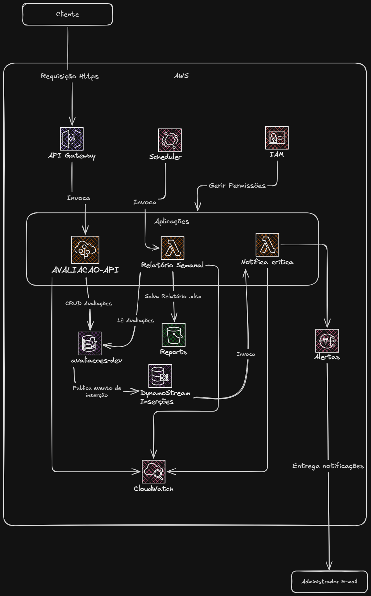

# Tech Challenge — Fase 4: Plataforma de feedbacks de aulas

Plataforma Java 21 para registrar avaliações, enviar alertas de urgência e gerar relatórios semanais em Excel. A infraestrutura AWS é declarada com SAM/CloudFormation e o deploy é automatizado pelo GitHub Actions.

## Sumário

- [Visão geral](#visão-geral)
- [Arquitetura e integrações](#arquitetura-e-integrações)
- [Desenho da arquitetura](#desenho-da-arquitetura)
- [Pré-requisitos e testes](#pré-requisitos-e-testes)
- [App: avaliacao-api](#app-avaliacao-api)
- [App: notificar-critica](#app-notificar-critica)
- [App: relatorio-semanal](#app-relatorio-semanal)
- [Execução local com LocalStack](#execução-local-com-localstack)
- [Deploy e CI/CD](#deploy-e-cicd)
- [Segurança e observabilidade](#segurança-e-observabilidade)
- [Limitações de integração](#limitações-de-integração)
- [Documentação complementar](#documentação-complementar)

## Visão geral

| Aplicação | Tecnologia | Hospedagem AWS | Responsabilidade |
| --- | --- | --- | --- |
| `avaliacao-api` | Spring Boot, Java 21 | Elastic Beanstalk / EC2 | Criar, listar, buscar e excluir avaliações; publicar eventos |
| `notificar-critica` | Quarkus, Java 21 | Lambda | Consumir DynamoDB Streams e publicar alertas SNS |
| `relatorio-semanal` | Quarkus, Java 21 | Lambda | Consolidar avaliações, gerar XLSX e salvar no S3 |

A arquitetura atual é híbrida. Para torná-la totalmente serverless, seria necessário migrar a API para Lambda e alterar o API Gateway. Essa migração não está implementada.

```text
.
├── avaliacao-api/                  # API com POM e Maven Wrapper próprios
├── notificar-critica/              # Lambda de alertas e evento de exemplo
├── relatorio-semanal/              # Lambda de relatórios e ambiente LocalStack
├── bootstrap/github-oidc-role.yaml # Acesso inicial do GitHub à AWS
├── docs/                          # Guias complementares
├── .github/workflows/ci-cd.yml     # Testes e deploy
├── pom.xml                        # Agregador somente das duas Lambdas
├── template.yaml                  # Infraestrutura e integrações AWS
└── samconfig.toml                 # Configuração padrão SAM
```

## Arquitetura e integrações

### Entrada de avaliações

`Cliente → API Gateway → Elastic Beanstalk → avaliacao-api → DynamoDB`

O API Gateway fornece entrada HTTPS e encaminha `ANY /api/{proxy+}` ao Beanstalk. A API recebe o tráfego na porta 5000 no ambiente AWS. O Beanstalk está configurado como `SingleInstance`, sem load balancer, com uma EC2 `t3.small` por padrão.

Na criação, a API salva a avaliação e depois publica `AVALIACAO_CRIADA` no tópico SNS `avaliacao-eventos-${Stage}`. Não há assinantes desse tópico definidos no template: ele não aciona a Lambda de alertas atualmente.

### Alertas

`DynamoDB → DynamoDB Streams → notificar-critica → SNS de alertas → e-mail`

O gatilho encaminha somente `INSERT`. A Lambda classifica a nota e publica no tópico `alertas-criticos-${Stage}`. O administrador precisa confirmar a assinatura enviada pelo SNS para receber e-mails.

### Relatório semanal

`EventBridge Scheduler → relatorio-semanal → DynamoDB → XLSX → S3`

O agendamento executa às segundas-feiras às 08h, em `America/Sao_Paulo`. A função lê a tabela com Scan paginado, filtra o período em memória e publica no prefixo `reports/` do bucket privado. Os arquivos expiram após 90 dias.

| Recurso | Configuração declarada |
| --- | --- |
| Stack / região padrão | `feedback-aulas-dev` / `us-east-1` |
| Ambientes do template | `dev` e `prod` |
| Tabela | `avaliacoes-${Stage}`, chave `id` String, cobrança por requisição |
| Stream | `NEW_IMAGE` |
| Lambdas | Java 21, ARM64, 512 MB |
| Timeout de notificação / relatório | 30 s / 60 s |
| Logs | CloudWatch, retenção configurada em 7 dias |

Esses valores descrevem os arquivos do repositório, não uma consulta ao estado atual da conta AWS.

## Desenho da arquitetura



## Pré-requisitos e testes

- JDK 21 e Maven disponíveis no terminal.
- Docker Desktop em modo Linux para LocalStack e SAM local.
- Token LocalStack com licença válida para a imagem usada pelo Compose.
- AWS CLI e SAM CLI para deploy e invocações com SAM.
- Perfil/credenciais AWS para aplicações locais que acessam serviços reais.

Os comandos usam PowerShell e partem da raiz do repositório, salvo indicação contrária.

```powershell
java -version
mvn -version
docker version

# Compila e testa somente as duas Lambdas
mvn clean verify

# Compila e testa a API separadamente
mvn -f avaliacao-api/pom.xml clean verify

# Testes individuais
mvn -pl notificar-critica -am test
mvn -pl relatorio-semanal -am test
```

As Lambdas geram `target/function.zip` em cada módulo. A API gera um JAR em `avaliacao-api/target/`.

## App: avaliacao-api

### Responsabilidade e organização

API REST organizada em `presentation` (HTTP e contratos), `application` (casos de uso), `domain` (entidades, regras e interfaces) e `infra` (DynamoDB, SNS e configuração).

| Método | Caminho | Sucesso |
| --- | --- | --- |
| POST | `/api/avaliacao/v1` | `201`, criação |
| GET | `/api/avaliacao/v1` | `200`, listagem |
| GET | `/api/avaliacao/v1/{id}` | `200`, busca por UUID |
| DELETE | `/api/avaliacao/v1/{id}` | `204`, exclusão |
| GET | `/actuator/health` | Health check direto da aplicação |

Exemplo de criação, com nota entre 0 e 10:

```json
{
  "descricao": "A aula apresentou bons exemplos práticos",
  "nota": 9
}
```

Coleção de requisições: [Avaliacao.postman_collection.json](avaliacao-api/Avaliacao.postman_collection.json).

### Configuração

| Variável / propriedade | Uso | Padrão |
| --- | --- | --- |
| `AWS_REGION` | Região AWS | `us-east-1` |
| `AWS_DYNAMODB_ENDPOINT` | Endpoint alternativo somente do DynamoDB | Vazio, usa AWS |
| `AWS_SNS_AVALIACAO_TOPIC_ARN` | Tópico de eventos | Vazio; definir para criar avaliações |
| `aws.profile` | Perfil opcional dos clientes | Cadeia padrão de credenciais |
| `SERVER_PORT` | Porta HTTP | 8080 local; Beanstalk configura 5000 |

A tabela está fixa em `avaliacoes-dev` no código. O cliente SNS não tem endpoint alternativo implementado: configurar DynamoDB local não torna toda a API local.

### Executar localmente usando serviços AWS

Pré-condições: tabela `avaliacoes-dev` e tópico SNS existentes na região escolhida. O perfil deve permitir operações na tabela e publicação no tópico.

```powershell
# Configure/autentique previamente um perfil autorizado.
$env:AWS_PROFILE = "seu-perfil"
$env:AWS_REGION = "us-east-1"
$env:AWS_SNS_AVALIACAO_TOPIC_ARN = "arn:aws:sns:us-east-1:SEU_ACCOUNT_ID:avaliacao-eventos-dev"
$env:SERVER_PORT = "8080"

mvn -f avaliacao-api/pom.xml spring-boot:run
```

Em outro terminal:

```powershell
Invoke-RestMethod -Uri "http://localhost:8080/actuator/health"

$body = @{ descricao = "Feedback enviado localmente"; nota = 9 } | ConvertTo-Json
Invoke-RestMethod -Method Post -Uri "http://localhost:8080/api/avaliacao/v1" -ContentType "application/json" -Body $body

Invoke-RestMethod -Uri "http://localhost:8080/api/avaliacao/v1"
```

O processo Java é local, mas grava/publica na AWS real. Se a tabela estiver ligada à Lambda de notificação, a inserção também poderá disparar alertas na nuvem.

## App: notificar-critica

### Responsabilidade e regras

`NotificarCriticaHandler` recebe lotes de eventos do DynamoDB Streams, extrai `NewImage`, classifica a nota e publica no SNS.

| Urgência | Regra padrão | Comportamento atual |
| --- | --- | --- |
| `HIGH` | Nota <= 4 | Publica alerta |
| `MEDIUM` | Nota > 4 e < 7 | Publica alerta |
| `LOW` | Nota >= 7 | Registra no log, sem alerta |

O limite de `HIGH` é configurável; o corte de `MEDIUM` é 7. Apesar do nome, o handler atual envia alertas para `HIGH` e `MEDIUM`.

O mapper lê `id`, `descricao`, `nota` e aceita `dataEnvio` ou `data`. Evento de exemplo: [stream_critical.json](notificar-critica/events/stream_critical.json).

### Configuração

| Variável | Uso | Padrão |
| --- | --- | --- |
| `TOPICO_ALERTAS_ARN` | Tópico SNS de destino | Definir antes de publicar |
| `LIMITE_NOTA_CRITICA` | Limite de `HIGH` | `4` |
| `QUARKUS_LAMBDA_HANDLER` | Handler | `notificar-critica` |
| `AWS_REGION` | Região do cliente AWS | Definir na execução local |

O gatilho AWS usa lotes de até 10 registros, até duas novas tentativas e divisão do lote em caso de erro. Falhas de publicação provocam exceção; reprocessamentos podem duplicar alertas.

### Testar e invocar localmente

```powershell
mvn -pl notificar-critica -am test
mvn -pl notificar-critica -am package
```

Para invocar pelo SAM, crie `env.notificar.local.json`, substituindo o ARN por um tópico de teste existente:

```json
{
  "NotificarCriticaFunction": {
    "TOPICO_ALERTAS_ARN": "arn:aws:sns:us-east-1:SEU_ACCOUNT_ID:alertas-criticos-dev",
    "LIMITE_NOTA_CRITICA": "4",
    "QUARKUS_LAMBDA_HANDLER": "notificar-critica"
  }
}
```

Com Docker ativo e perfil AWS autenticado:

```powershell
sam local invoke NotificarCriticaFunction --template template.yaml --event notificar-critica/events/stream_critical.json --env-vars env.notificar.local.json --profile seu-perfil --region us-east-1
```

O runtime Lambda executa localmente com o evento fornecido, sem criar um gatilho real de Streams. A publicação usa SNS real e pode enviar e-mail. O Compose do relatório não provisiona SNS nem esta Lambda.

## App: relatorio-semanal

### Responsabilidade e organização

`WeeklyReportLambdaHandler` chama `GenerateWeeklyReportUseCase`. A porta `EvaluationReader` é implementada pelo adaptador DynamoDB, e `ReportPublisher` pelo adaptador S3. `ReportConsolidator` calcula os indicadores, e `XlsxReportGenerator` utiliza o template em `src/main/resources/templates/weekly-report.xlsx`.

O XLSX inclui total de avaliações, média das notas, totais por dia, totais por urgência e avaliações do período. A classificação usa cortes fixos: `HIGH <= 4`, `MEDIUM < 7` e `LOW >= 7`.

O período começa à meia-noite de sete dias antes da execução, em `America/Sao_Paulo`, e termina no instante da execução, com início inclusivo e fim exclusivo. Na segunda às 08h, inclui também as primeiras oito horas da segunda atual.

### Configuração

| Variável | Uso na AWS |
| --- | --- |
| `TABELA_AVALIACOES` | Tabela consultada |
| `BUCKET_RELATORIOS` | Bucket de destino |
| `AWS_REGION` | Região AWS |
| `QUARKUS_LAMBDA_HANDLER` | `relatorio-semanal` |

O perfil `dev` usa endpoints `http://localhost:4566`, credenciais fictícias `test/test`, tabela `evaluations-local` e bucket `weekly-reports-local`. A porta pode ser alterada com `LOCALSTACK_PORT`.

## Execução local com LocalStack

Este ambiente prepara DynamoDB, S3, Lambda e logs para testar **somente o relatório semanal**. Não sobe API, notificação, SNS, API Gateway ou agendamento; não é uma execução integrada das três aplicações.

### 1. Preparar e iniciar

Crie `.env-local` na raiz, sem versionar o token:

```dotenv
LOCALSTACK_AUTH_TOKEN=SEU_TOKEN_LOCALSTACK
```

Execute na raiz:

```powershell
mvn -pl relatorio-semanal -am clean package -DskipTests

docker compose --env-file .env-local -f relatorio-semanal/src/main/docker/local/compose.yaml up -d --build --wait --wait-timeout 600

docker compose --env-file .env-local -f relatorio-semanal/src/main/docker/local/compose.yaml ps
```

O hook cria tabela `evaluations-local`, bucket privado `weekly-reports-local`, dados de exemplo e função `weekly-reports`. O pacote `relatorio-semanal/target/function.zip` deve existir antes de iniciar o container. A função local usa 1024 MB e timeout de 120 s.

A carga em `relatorio-semanal/src/main/docker/local/evaluations.json` contém datas fixas de 01 a 07/11/2026. Ajuste-as para o período desejado e recrie a imagem. Fora da janela, o relatório pode ficar vazio.

### 2. Invocar e conferir

```powershell
docker compose --env-file .env-local -f relatorio-semanal/src/main/docker/local/compose.yaml exec localstack awslocal lambda invoke --function-name weekly-reports --payload '{}' /tmp/lambda-response.json

docker compose --env-file .env-local -f relatorio-semanal/src/main/docker/local/compose.yaml exec localstack cat /tmp/lambda-response.json

docker compose --env-file .env-local -f relatorio-semanal/src/main/docker/local/compose.yaml exec localstack awslocal logs filter-log-events --log-group-name /aws/lambda/weekly-reports --query "events[].message" --output text

docker compose --env-file .env-local -f relatorio-semanal/src/main/docker/local/compose.yaml exec localstack awslocal s3 ls s3://weekly-reports-local/reports/ --recursive
```

Confira ausência de `FunctionError`, resposta `null`, logs de conclusão e XLSX no S3. `StatusCode: 200` sozinho não comprova sucesso da função.

Para baixar, substitua o nome pela chave mostrada na listagem:

```powershell
docker compose --env-file .env-local -f relatorio-semanal/src/main/docker/local/compose.yaml exec localstack awslocal s3 cp s3://weekly-reports-local/reports/NOME_DO_ARQUIVO.xlsx /tmp/relatorio.xlsx

docker compose --env-file .env-local -f relatorio-semanal/src/main/docker/local/compose.yaml cp localstack:/tmp/relatorio.xlsx ./relatorio.xlsx
```

### 3. Atualizar e encerrar

Depois de alterar Java, recompile e publique com o container ativo:

```powershell
mvn -pl relatorio-semanal -am package -DskipTests
docker compose --env-file .env-local -f relatorio-semanal/src/main/docker/local/compose.yaml exec localstack bash /opt/weekly-reports/deploy-lambda.sh
```

Alterações nos scripts, Dockerfile ou dados exigem recriar a imagem usando o comando `up` com `--build`. Para encerrar preservando o volume:

```powershell
docker compose --env-file .env-local -f relatorio-semanal/src/main/docker/local/compose.yaml down
```

O teste local não comprova IAM real, agendamento ou comportamento de retries AWS.

## Deploy e CI/CD

A infraestrutura está no [template.yaml](template.yaml). O [workflow](.github/workflows/ci-cd.yml) executa:

1. Em PRs para `main`: testes/build das Lambdas e API, além de `cfn-lint`.
2. Em push na `main` ou execução manual na `main`: autenticação AWS por OIDC após os testes.
3. Empacotamento das Lambdas e envio do bundle da API para S3.
4. Descoberta da plataforma Beanstalk Corretto 21 / Amazon Linux 2023.
5. `sam deploy` para criar ou atualizar os recursos.
6. Smoke test do POST: `201` com dados válidos e `400` com nota inválida.

Secrets GitHub: `AWS_DEPLOY_ROLE_ARN` e `ADMIN_EMAIL`. O bootstrap está em [github-oidc-role.yaml](bootstrap/github-oidc-role.yaml).

Para deploy manual, compile as três aplicações e prepare/envie o bundle com JAR e `Procfile`, conforme o workflow. Os parâmetros são:

| Parâmetro | Uso |
| --- | --- |
| `Stage` | `dev` ou `prod` |
| `AdminEmail` | Destinatário SNS |
| `LimiteNotaCritica` | Limite de urgência alta, padrão 4 |
| `AppBundleBucket` | Bucket do bundle da API |
| `AppBundleKey` | Chave do ZIP; uma nova por versão |
| `SolutionStackName` | Nome completo da plataforma Beanstalk |
| `InstanceType` | EC2, padrão `t3.small` |

O `samconfig.toml` não preenche todos os parâmetros obrigatórios da API. Apenas `mvn package` e `sam deploy` não preparam um primeiro deploy completo; use o workflow como referência do processo. Não é necessário `sam build`, pois o template aponta para os ZIPs Maven.

Outputs disponíveis no CloudFormation:

- `ApiUrl`: URL oficial; acrescente `/api/avaliacao/v1`.
- `BeanstalkUrl`: endereço direto para diagnóstico.
- `TopicoAvaliacoesArn`, `TopicoAlertasArn`, `TabelaAvaliacoes` e `BucketRelatorios`: recursos de integração.

## Segurança e observabilidade

- A API usa a role da EC2; cada Lambda usa sua própria role IAM.
- GitHub Actions autentica por OIDC, sem access keys fixas no workflow.
- Credenciais locais devem vir de perfil ou ambiente, sem serem gravadas no código.
- Logs da API e das Lambdas são enviados ao CloudWatch, com retenção configurada de 7 dias.
- O bucket de relatórios bloqueia acesso público e expira objetos em 90 dias.
- O template não configura autenticação/autorizador no API Gateway.
- O custo da solução inclui a EC2 continuamente ligada no Beanstalk.

## Limitações de integração

| Ponto | Estado atual / impacto |
| --- | --- |
| Data | API grava `data`, mas relatório exige `dataEnvio`. É necessário alinhar o contrato. |
| Tabela da API | Fixa em `avaliacoes-dev`; precisa acompanhar o parâmetro de ambiente. |
| Alertas | Handler envia `HIGH` e `MEDIUM`; alguns comentários ainda citam somente críticos. |
| Limite de urgência | Configurável na notificação, fixo em 4 no relatório; podem divergir. |
| SNS de avaliações | Publicação sem consumidor definido. Alertas vêm de Streams. |
| Consistência | DynamoDB e SNS são operações separadas. Publicação pode falhar após persistir. |
| Reprocessamento | Handler não deduplica alertas; retries podem repetir publicações. |
| Relatório | Scan de toda a tabela e filtro em memória precisam de revisão para volumes maiores. |
| Ambiente totalmente local | Compose cobre somente relatório. Faltam SNS, API, Stream e gatilho de notificação, além de alinhar tabela e contrato. |
| Guias antigos | Podem mencionar três Lambdas, `/avaliacao` ou JSON. Para o estado atual, consulte código, template e este README. |

Contrato esperado pelo relatório: `id` (String/UUID), `descricao` (String), `nota` (Number) e `dataEnvio` (String ISO-8601). A persistência atual da API usa `data` no lugar de `dataEnvio`.

## Documentação complementar

- [Infraestrutura e deploy](docs/GUIA_INFRA.md)
- [Segurança e monitoramento](docs/SEGURANCA_E_MONITORAMENTO.md)
- [Roteiro de demonstração](docs/ROTEIRO_DEMONSTRACAO.md)
- [Lambda de notificação](notificar-critica/README.md)
- [Ambiente local do relatório](relatorio-semanal/src/main/docker/local/README.md)
- [Lambda de relatório no LocalStack](relatorio-semanal/src/main/docker/local/LAMBDA.md)

Nos guias locais do relatório, caminhos `src/main/docker/local/compose.yaml` são relativos à pasta `relatorio-semanal/`. Neste README, os comandos partem da raiz e usam Maven instalado: o módulo de relatório não possui Maven Wrapper próprio.
